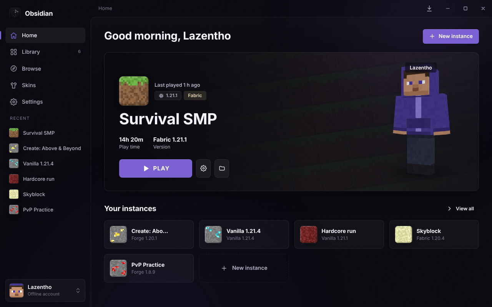
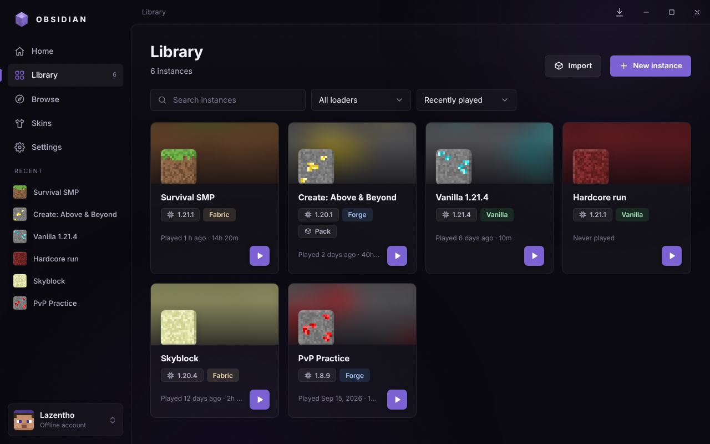
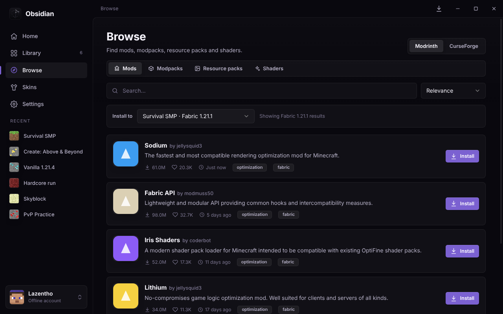
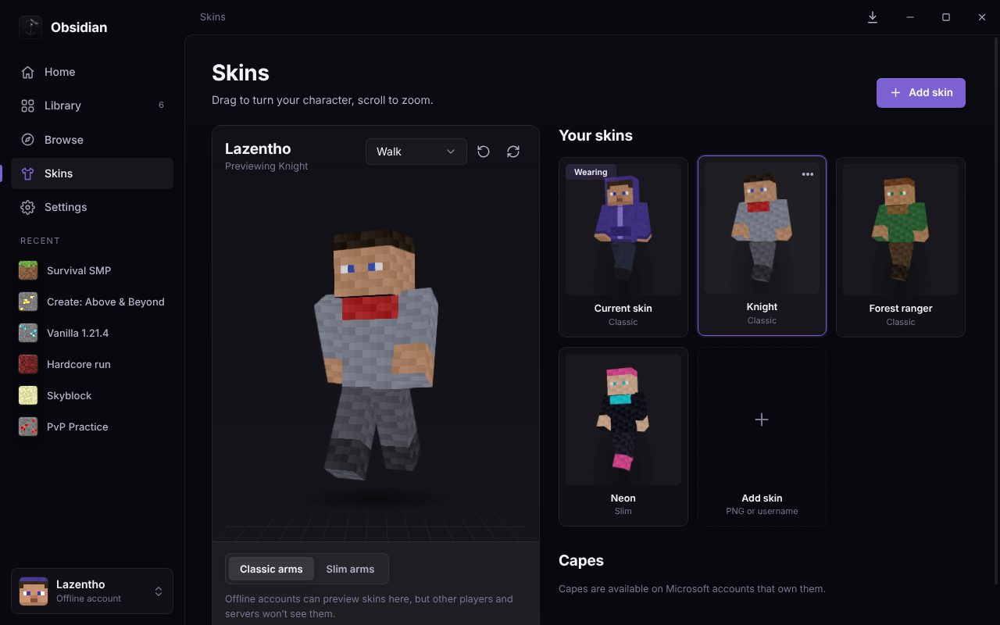
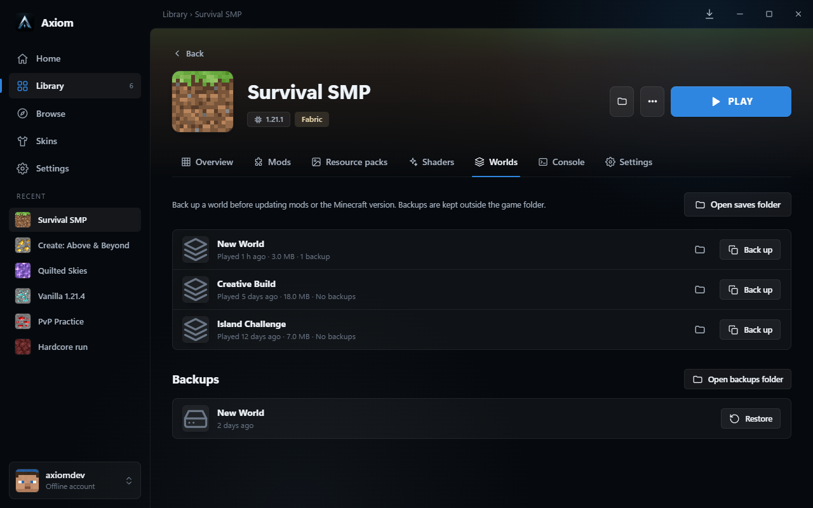
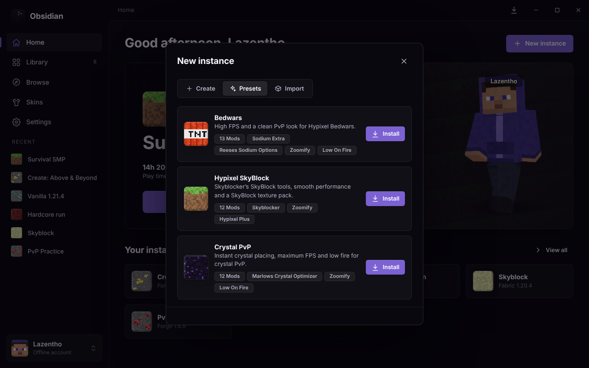
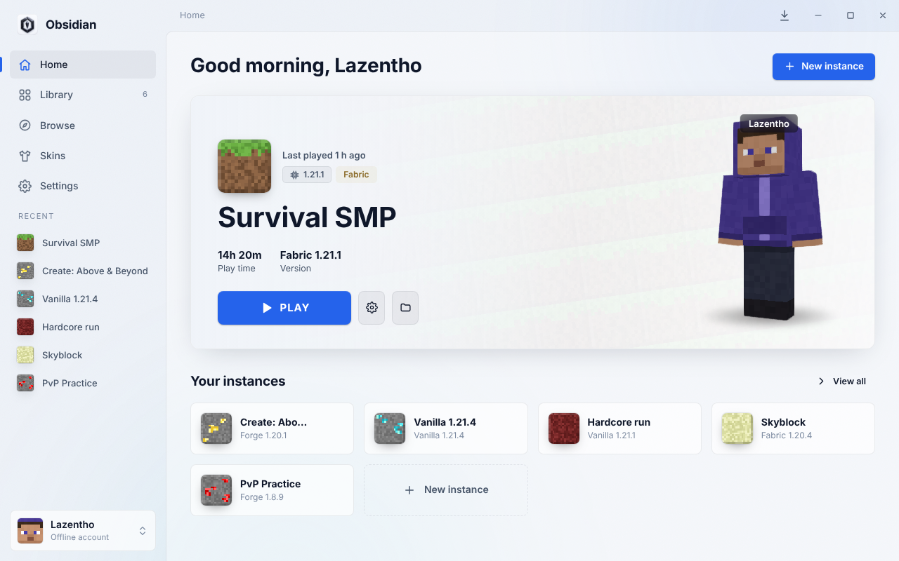
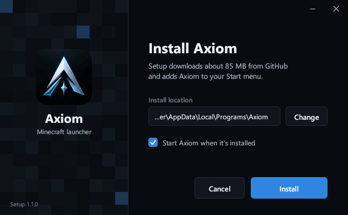

# Axiom

A custom Minecraft launcher for Windows. Play with Microsoft or offline accounts, run as many separate instances as you like, add Fabric, Quilt or Forge, and install mods, modpacks, resource packs and shaders without leaving the app.



## Features

- **Accounts**: Microsoft sign in and offline accounts with any username, with quick switching between them
- **Instances**: each one has its own version, mods, worlds, settings, RAM and Java arguments
- **Mod loaders**: Vanilla, Fabric, Quilt and Forge, installed automatically when you press Play. Quilt instances can also use Fabric mods
- **Browse**: search Modrinth (no key needed) and CurseForge (needs a key) for mods, modpacks, resource packs and shaders. Required dependencies install automatically
- **Modpacks**: install from Modrinth or CurseForge, import `.mrpack`, CurseForge `.zip` and Prism or MultiMC exports, export your own instances as `.mrpack`, and update packs in place
- **Worlds and backups**: see every world in an instance, back one up in one click, and restore a backup as a new world without overwriting anything
- **Crash reports**: when Minecraft crashes, open its crash report straight from the notification
- **Skins**: a 3D viewer with animations, a skin library with 3D previews, skin upload for Microsoft accounts, and cape switching
- **Java**: the right Java version is downloaded automatically for every Minecraft version
- **Discord status**: shows "Playing Minecraft, using Axiom Launcher" with your version and play time
- **Themes**: Axiom, Midnight, Ember, Forest, Nether, The End and Frost, plus custom accent colours
- **Downloads panel** with progress, speed and cancel buttons. Stalled downloads time out and retry on their own
- **Presets**: one click Bedwars, Hypixel SkyBlock and Crystal PvP instances with performance mods, texture packs and tuned settings
- **Custom installer** with its own look that downloads the latest version, plus automatic updates

| Library | Browse | Skins |
| --- | --- | --- |
|  |  |  |

| Worlds and backups | Presets | Frost theme |
| --- | --- | --- |
|  |  |  |

## Install

Download `Axiom-Setup.exe` from the [latest release](https://github.com/Axiom-Dev123442/axiom-launcher/releases/latest) and run it. It downloads the latest Axiom, installs it with Start menu and desktop shortcuts, and starts it. Axiom updates itself after that. `Axiom-Full-Setup.exe` on the same page is the standard offline installer.



### Coming from Obsidian

Axiom was previously released as Obsidian. On first start it moves `%APPDATA%\.obsidian` to `%APPDATA%\.axiom`, so your instances, worlds, offline accounts and downloaded Java carry over. Microsoft accounts need to sign in once more.

## Setup notes

### Microsoft login
Axiom has a Microsoft app ID built in. Mojang has to approve that app before Minecraft accepts sign ins, so Microsoft login only works once the app at [aka.ms/mce-reviewappid](https://aka.ms/mce-reviewappid) is approved. Offline accounts work without it.

### CurseForge
CurseForge requires a free API key from [console.curseforge.com](https://console.curseforge.com). Paste it into **Settings → Integrations**. The key stays on your PC. Modrinth works without a key.

### Discord status
1. Create an application at [discord.com/developers/applications](https://discord.com/developers/applications) and name it **Minecraft** (Discord shows "Playing" followed by this name).
2. Under **Rich Presence → Art Assets**, upload [`assets/discord/axiom.png`](assets/discord/axiom.png) with the name `axiom`.
3. Paste the **Application ID** into **Settings → Discord**, or into `BUILT_IN.discordClientId` in `src/core/settings.js` so everyone gets it.

## Security

- Modpacks can only download files from the hosts Modrinth's pack format allows (`cdn.modrinth.com`, `github.com`, `raw.githubusercontent.com`, `gitlab.com`), over https, and every file is checked against its hash.
- Pack files and zip entries can never be written outside the instance folder.
- Microsoft tokens are encrypted with Windows' own data protection and are never shown to the interface.
- The interface runs sandboxed with context isolation, and can only open https links.

## Development

Requires Node.js 22.

```bash
npm install
npm start          # run the launcher
npm test           # unit and end-to-end tests
npm run dist       # build the full Windows installer into dist/
npm run setup      # build the custom installer (Rust) into installer/target/release/
npm run icons      # regenerate icons and installer images from the logo (Windows)
npm run screenshots # regenerate docs/screenshots with demo data
```

Building the Windows installer needs Windows (or Wine on Linux). GitHub Actions builds it on every push: open the run under **Actions** and download the **Axiom-Windows** artifact.

### Publishing a release

1. Bump `version` in `package.json` (for example `1.2.0`).
2. Commit, then push a matching tag: `git tag v1.2.0 && git push origin v1.2.0`.
3. GitHub Actions publishes a release with `Axiom-Setup.exe` (custom installer) and `Axiom-Full-Setup.exe`. Existing installs update themselves.

### Project layout

```
src/core/       launcher engine: downloads, Java, loaders, accounts, mods, modpacks, worlds, skins, Discord
src/main/       Electron main process, preload bridge and auto updater
src/renderer/   the interface (plain JavaScript modules and CSS, no build step)
test/           unit tests and end-to-end tests against fake Mojang, Fabric, Forge and CurseForge servers
installer/      the custom installer (Rust, egui): downloads and silently runs Axiom-Full-Setup.exe
scripts/        icon and installer image generator
```

### Data folder

Everything lives in `%APPDATA%\.axiom`: shared game files (`versions`, `libraries`, `assets`), downloaded Java (`runtimes`), and one folder per instance under `instances`, with world backups in each instance's `backups` folder. Set `AXIOM_HOME` to use a different folder.

## Legal

Axiom is not affiliated with Mojang Studios or Microsoft. Minecraft is a trademark of Mojang Studios. Axiom ships no game files. Minecraft, its textures and Java are downloaded from official sources on your computer.

Released under the [MIT License](LICENSE).
